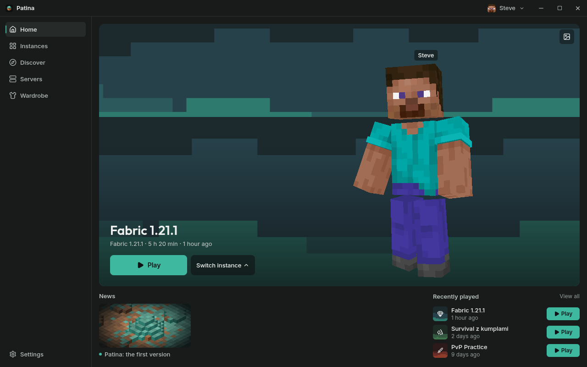
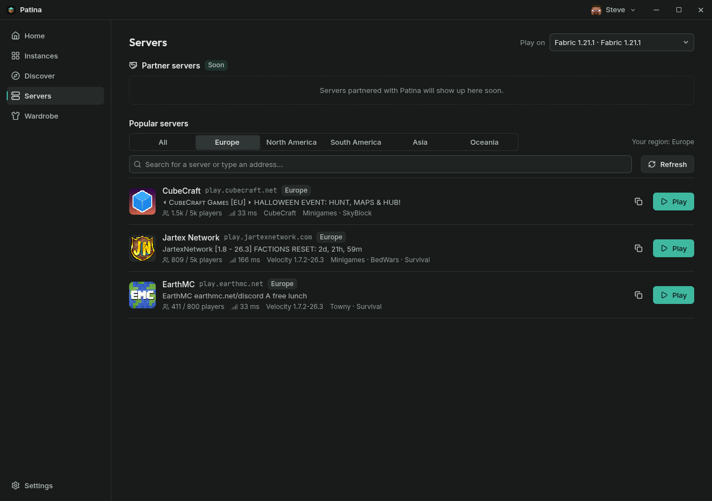
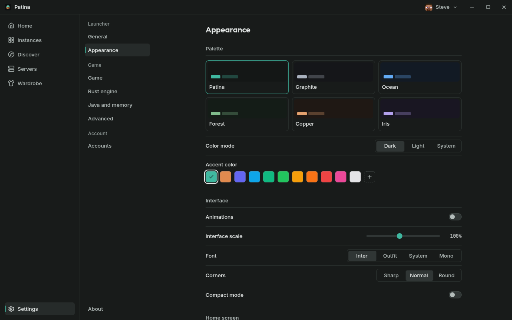
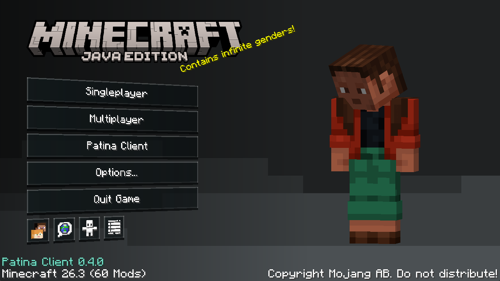
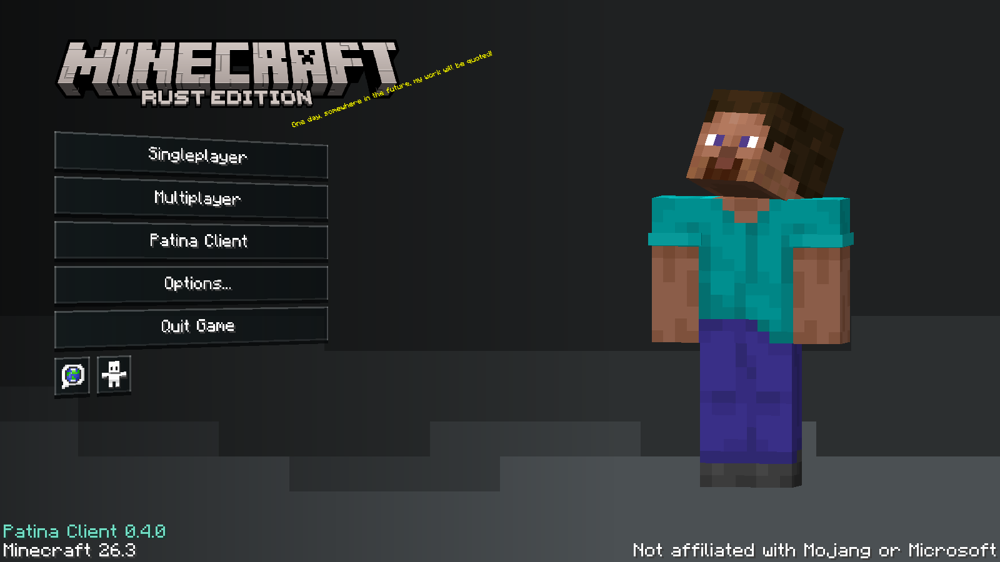
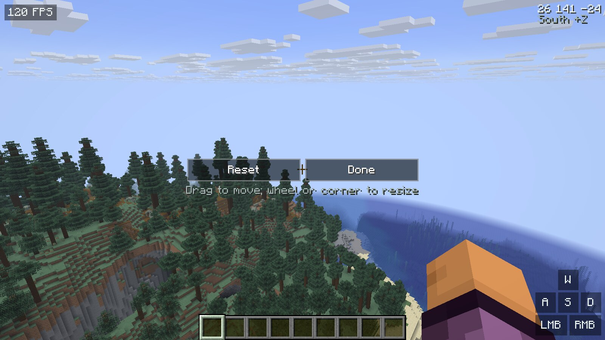
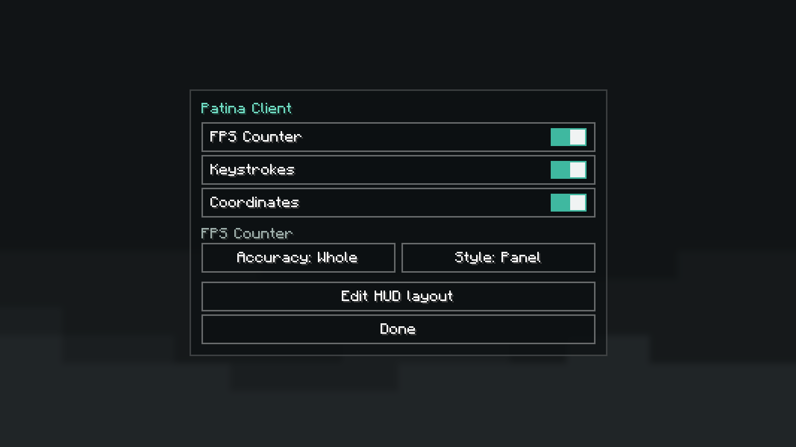

<div align="center">


# Patina

**A quiet Minecraft launcher, with its own client for Fabric and a native Rust client.**

[Download](https://project-patina.github.io/patina/) · [Releases](https://github.com/project-patina/patina/releases) · [Rust client](engine/README.md) · [Changelog](CHANGELOG.md) · [Contributing](CONTRIBUTING.md)



</div>

## What it is

Patina is a desktop launcher for Minecraft: Java Edition, built with Svelte 5, Tauri 2 and
Rust. It keeps instances, accounts, mods and skins in one calm interface, and ships the
**Patina Client** in two forms that look and behave the same:

- **on Fabric 26.3**, as a mod the launcher installs before each start;
- **as a native Rust client** for 26.3, derived from [Horizon](https://github.com/horizon-rust/horizon).

Linux is the main platform. Windows builds are cross-compiled and less tested; macOS is not
supported yet.

## Launcher

- Fabric and Rust instances with their own folders, Java and memory settings.
- Microsoft sign-in, several accounts, skins and capes with a 3D preview.
- **Servers**: well-known servers with their region, players and ping, a search that
  checks any address, and one click to start an instance and join.
- Mods, resource packs and shaders from Modrinth for compatible instances.
- Six palettes, dark and light modes, Polish and English.
- Signed self-updates for the portable packages.

<p align="center">
  
  
</p>

## Patina Client

The same frontend in both clients: the main menu, the settings, the built-in mods and
their look.

- A main menu with a turned stack of buttons, the player's own skin and the launcher's
  black Mono background.
- Built-in mods: FPS counter, keystrokes and coordinates.
- A **HUD editor** over the game itself: drag each mod where you want it, resize it with
  its corner or the mouse wheel. What you place is exactly where it shows in game.

<p align="center">
  
  
</p>

<p align="center">
  
  
</p>

## Download

Get the latest build from the [download page](https://project-patina.github.io/patina/)
or the [releases](https://github.com/project-patina/patina/releases). Each package holds
the launcher and the Rust client; unpack it anywhere and start Patina from the
`launcher` folder. You need a Minecraft: Java Edition account.

## Build from source

Requirements: Node.js 22.14+, a current stable Rust with Clippy, JDK 25 for the Fabric mod,
Python 3.11+ and the [Tauri prerequisites](https://v2.tauri.app/start/prerequisites/).

```sh
npm ci
sh scripts/build-java-mod.sh   # the integrated Fabric mod
npm run app                    # the launcher, in development
sh scripts/install-engine.sh   # the Rust client (Linux)
```

`npm run dev` opens a browser preview with a fake backend at `http://127.0.0.1:1420/`.
`sh scripts/install-dev.sh` installs **Patina Dev** beside a stable Patina, with its own
data folder. The checks CI runs:

```sh
npm run check && npm test
cargo test --workspace --locked
cargo clippy --workspace --all-targets --locked -- -D warnings
cargo test --manifest-path engine/Cargo.toml --locked -p patina-client
```

| Folder | Contents |
| --- | --- |
| `src/` | The launcher's interface |
| `src-tauri/` | Window, commands and system integration |
| `crates/core/` | Accounts, downloads, Java, instances, servers and launching |
| `java-mod/` | The Patina Client for Fabric |
| `engine/` | The Rust client, server and tools |
| `scripts/` | Builds, packaging and release tooling |

## Made with AI

Patina is vibecoded: AI tools wrote much of it, with the maintainer setting the
direction and checking the results. That is not a guarantee of correctness. This is
an early release; back up important worlds before trying another client or version.

## License

Patina's own code is [MIT](LICENSE), © 2026 Patina contributors (project-patina).
The Rust client is derived from Horizon by **Ludovic Marie and the Horizon contributors**,
whose MIT notice stays in [engine/LICENSE](engine/LICENSE); see
[engine/UPSTREAM.md](engine/UPSTREAM.md) and [THIRD_PARTY_NOTICES.md](THIRD_PARTY_NOTICES.md).

Minecraft's game files, skins and downloaded content are not part of this repository and
are not relicensed. **Not an official Minecraft product.** Not approved by or associated
with Mojang or Microsoft, nor endorsed by the Horizon maintainers.

## Po polsku

Patina to spokojny launcher Minecraft: Java Edition z własnym klientem: modem na Fabric
26.3 i natywnym klientem w Rust, które wyglądają i działają tak samo. Ma instancje,
konta Microsoft, skiny, mody z Modrinth, listę serwerów i edytor HUD-u w grze.
Pobierz go ze [strony](https://project-patina.github.io/patina/). Kod jest na licencji MIT,
a autorstwo Horizon pozostaje zachowane.
