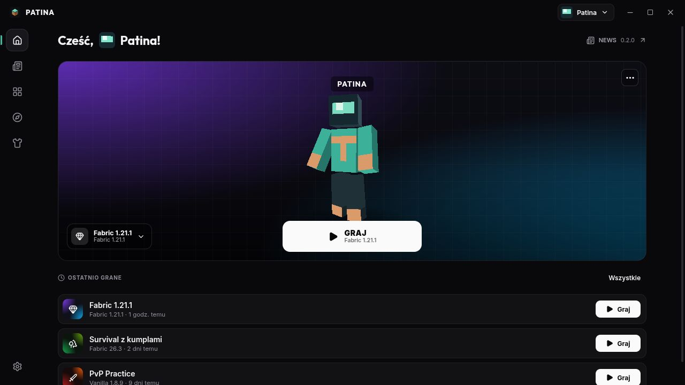
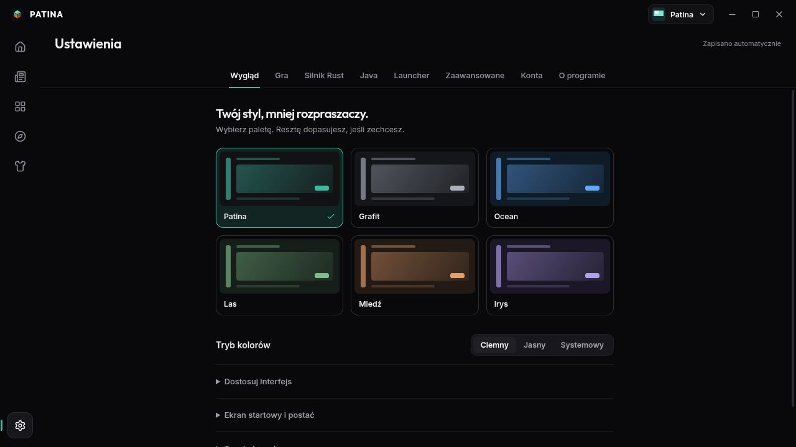

<div align="center">


# Patina — Launcher & Client

A minimal Minecraft launcher with an optional Horizon-derived Rust client.

**Open source · MIT · Vibecoded · Early development**

[Getting started](#getting-started) · [Rust client](engine/README.md) · [Contributing](CONTRIBUTING.md) · [Licensing](#license-and-attribution)

</div>

Patina brings instance management, Microsoft sign-in, mods, skins and themes into
a quiet desktop interface. The launcher uses **Svelte 5, TypeScript, Tauri 2 and
Rust**. Both the launcher and the optional native Rust client are included here.

> **Credit where it belongs:** the Rust client in `engine/` is a modified
> derivative of [Horizon](https://github.com/horizon-rust/horizon), originally
> created by **Ludovic Marie and the Horizon contributors**, under MIT.
> Its original copyright and license remain in [engine/LICENSE](engine/LICENSE).
> Renaming its crates to `patina-*` does not make inherited code original to Patina.

## Features

- Separate Vanilla, Fabric and Quilt instances, plus the optional Rust client
  pinned to Minecraft **26.3** in this source snapshot.
- A focused home screen, recent instances and offline NEWS with release notes.
- Six palettes — Patina, Graphite, Ocean, Forest, Copper and Iris — with dark,
  light and system modes.
- Modrinth browsing and installation of mods, resource packs and shaders for
  compatible instances.
- Skin and cape management, a 3D preview and a pose editor.
- Java, memory, window size, logs and per-instance launch settings.

The Rust client is a separate program, not a Java mod loader. Fabric/Quilt mod
compatibility does **not** imply those mods run in the Rust client.

## Vibecoded, openly

**Patina is vibecoded.** AI coding tools have been used extensively to implement,
iterate on and document the project, with the maintainer choosing the direction.
AI involvement is part of the development process, not a correctness guarantee.
Contributions should explain the change and how it was checked, whether written
by a person or with AI assistance.

This is an early development release. Bugs and platform differences are expected.
Launcher checks do not prove every Minecraft version, modpack or GPU works.
Keep backups of important worlds before testing a different client or version.

## Screenshots

These previews use original Patina demo artwork and synthetic accounts.





[NEWS screenshot](docs/screenshots/news.jpg)

## Getting started

Requirements: **Node.js 22.14+**, npm, a current stable **Rust** toolchain with
Clippy, Python 3.11+ for source-release checks, and the native dependencies in the
[Tauri prerequisites](https://v2.tauri.app/start/prerequisites/).
Some engine crates require Rust 1.90 or newer; use a current stable toolchain.

### Launcher

```sh
npm ci
npm run app
```

For a browser-only preview at `http://127.0.0.1:1420/`:

```sh
npm run dev
```

The preview uses fake accounts and original SVG textures. It cannot authenticate
Microsoft accounts or start a real game. Preview parameters include
`?page=settings&noanim`, `?page=news`, `?onboarding` and `?fps`.
The fake backend is excluded from production builds.

### Rust client

See [engine/README.md](engine/README.md) for requirements, limitations and upstream
attribution. On Linux, after installing the engine prerequisites:

```sh
sh scripts/install-engine.sh
```

Create a Rust instance in the launcher. Game resources are prepared locally from
the supported game installation; they are not included in this repository.
Preparation also requires the appropriate Java/JDK runtime.

### Checks and builds

```sh
npm run check
npm test
npm run build
python3 -m unittest discover -s tests -p 'test_*.py'
python3 scripts/prepare-source-release.py --check
cargo test --workspace --locked
cargo clippy --workspace --all-targets --locked -- -D warnings
npx tauri build --no-bundle
```

The Linux executable is `target/release/amethyst-launcher`. Historical
`amethyst-*` package names and the application ID are retained for data
compatibility; the visible product is Patina. The engine is a separate workspace:

```sh
cargo check --manifest-path engine/Cargo.toml --locked -p patina-client -p patina-prepare
```

Linux is the current development environment. A Windows cross-build script is
included; building it is not a Windows runtime compatibility guarantee. macOS has
not been validated for this launcher snapshot.

## Repository layout

| Directory | Contents |
| --- | --- |
| `src/` | Svelte frontend, themes and browser-preview fixtures |
| `src-tauri/` | Native window, IPC commands and application integration |
| `crates/core/` | Accounts, downloads, Java, instances and launch pipeline |
| `engine/` | Horizon-derived Rust client, server, preparer and tests |
| `resources/news.json` | Offline release notes |
| `scripts/` | Build, license collection and source-release tooling |
| `LICENSES/` | Notices for frontend fonts and libraries |

## Data and accounts

Linux launcher data defaults to `~/.local/share/amethyst`; `AMETHYST_ROOT` selects
another directory. `AMETHYST_ENGINE_DIR` overrides the engine location. Keep
accounts, tokens, worlds, logs, generated resources and local backups out of Git.
Read [SECURITY.md](SECURITY.md) before sharing diagnostics.

The Microsoft OAuth application ID in the source is a public identifier, not a
secret or a guarantee that every downstream build can use that registration.
Review the account integration before distributing your own build. Never embed
client secrets or real account fixtures. Engine network features, telemetry and
multiplayer are separate from the launcher's offline NEWS; review those settings
and their implementation when distributing a client build.

## License and attribution

Original Patina launcher code and Patina modifications are **MIT licensed**:
[LICENSE](LICENSE), copyright **2026 Patina contributors (project-patina)**.

The Horizon-derived client retains its original MIT copyright in
[engine/LICENSE](engine/LICENSE). Patina contributions to it have the additional
notice [engine/LICENSE-PATINA](engine/LICENSE-PATINA). See
[engine/UPSTREAM.md](engine/UPSTREAM.md) and
[THIRD_PARTY_NOTICES.md](THIRD_PARTY_NOTICES.md). These notices are cumulative;
Patina's license does not replace third-party copyrights or licenses.

Minecraft game files, account skins/capes, downloaded mods and third-party packs
are not relicensed by Patina and are excluded from the clean source export.
You need a legitimately owned Minecraft: Java Edition account/copy for supported
game features. **Not an official Minecraft product.** Not affiliated with or
endorsed by Mojang, Microsoft or the Horizon maintainers.

## Source releases

```sh
python3 scripts/prepare-source-release.py --output ../patina-opensource
```

This creates a clean source directory, archive, checksum and integrity manifest.
It does not create a GitHub repository or upload anything. Read
[docs/PUBLISHING.md](docs/PUBLISHING.md) before the first public push.

## Po polsku

Patina to otwartoźródłowy, minimalistyczny launcher Minecraft z opcjonalnym
klientem Rust opartym na Horizon. Projekt jest **vibecoded**: powstaje z dużym
udziałem narzędzi AI. Kod launchera i wkład Patiny są na MIT; oryginalne autorstwo
i licencja Horizon pozostają zachowane. Repozytorium nie zawiera kont, tokenów
ani plików gry. Zasady współpracy: [CONTRIBUTING.md](CONTRIBUTING.md).
